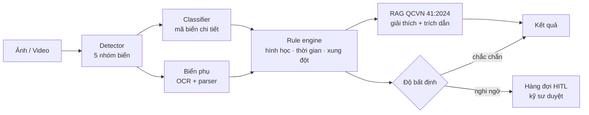

# QCVision

**Nhận dạng biển báo giao thông Việt Nam, giải thích theo QCVN 41:2024 và cảnh báo xung đột giữa các biển.**

> Đề tài **ADAS-08 – SignGuard VN** · Khối ADAS – Hệ thống hỗ trợ lái & Xe tự hành

---

## 1. Bài toán

Biển báo Việt Nam khác nhiều so với các bộ dữ liệu quốc tế: biển cấm theo giờ, biển phụ ghi điều kiện (giờ, loại xe), biển tạm thời tại công trường, biển bị che hoặc mờ, thậm chí hai biển mâu thuẫn trên cùng một đoạn đường. Mô hình train trên dữ liệu nước ngoài dễ nhận nhầm hoặc hiểu sai ý nghĩa của biển.

QCVision xây dựng một hệ thống:

- **Phát hiện và phân loại** biển báo Việt Nam theo 5 nhóm: cấm, nguy hiểm và cảnh báo, hiệu lệnh, chỉ dẫn, biển phụ.
- **Đọc biển phụ**: trích xuất điều kiện kèm theo (khung giờ, loại xe, khoảng cách).
- **Giải thích ý nghĩa biển** bằng RAG trên QCVN 41:2024/BGTVT, **bắt buộc trích dẫn điều khoản**, không suy diễn ngoài quy chuẩn.
- **Phát hiện xung đột và hết hiệu lực** giữa các biển liên tiếp trên một đoạn đường.
- **Ước lượng độ bất định** và chuyển các ca không chắc chắn cho kỹ sư duyệt (human-in-the-loop).

## 2. Tính năng (dự kiến)

### Cơ bản (MVP)
- [ ] Web app nạp ảnh/video đường phố
- [ ] Phát hiện và phân loại biển báo
- [ ] Hiển thị ý nghĩa biển kèm trích dẫn điều khoản QCVN 41:2024
- [ ] Đọc biển phụ cơ bản (giờ, loại xe)
- [ ] Báo cáo mAP và accuracy theo từng lớp
- [ ] 2 vai trò: kỹ sư và chuyên gia luật giao thông
- [ ] Hàng đợi HITL để duyệt các ca không chắc chắn

### Nâng cao
- [ ] Phát hiện xung đột và hết hiệu lực giữa các biển liên tiếp trên video
- [ ] Xử lý biển tạm thời tại công trường (biển tạm thời ưu tiên hơn biển cố định)
- [ ] Sinh ảnh tổng hợp có kiểm soát cho lớp hiếm
- [ ] Đánh giá chất lượng RAG (faithfulness, citation accuracy)
- [ ] Benchmark độ trễ và độ bền với mờ, che khuất, ngược sáng
- [ ] Công cụ chẩn đoán lỗi cho kỹ sư

## 3. Kiến trúc

| Module | Nhiệm vụ |
|---|---|
| **Detector** | Phát hiện biển trong ảnh, phân vào 5 nhóm lớn. Dùng SAHI cho biển nhỏ ở xa |
| **Classifier** | Phân loại mã biển chi tiết (P.123a, W.207…) trên ảnh cắt, xử lý mất cân bằng lớp |
| **Biển phụ** | OCR chữ trên biển phụ, parse thành JSON có cấu trúc `{giờ, loại xe, khoảng cách, ngoại lệ}` |
| **Rule engine** | Kiểm tra cố định (không dùng AI): hình dạng/màu khớp nhóm biển, nhãn ổn định qua các frame, xung đột và hết hiệu lực giữa các biển |
| **RAG** | Tra điều khoản theo mã biển, trả lời câu hỏi tự do, kiểm tra mọi trích dẫn trước khi trả về |
| **Uncertainty router** | Hiệu chuẩn độ tin cậy, conformal prediction, gộp các tín hiệu nghi ngờ để chuyển ca sang HITL |

## 4. Tech stack

| Phần | Công nghệ |
|---|---|
| Mô hình | Python, PyTorch, YOLO / RT-DETR / RF-DETR, ConvNeXt / ViT |
| Biển phụ | PaddleOCR (PP-OCRv5) |
| Tracking video | ByteTrack |
| RAG | Qdrant, Vietnamese_Embedding + Vietnamese_Reranker, LLM + LangGraph |
| Đánh giá | RAGAS / DeepEval |
| Backend | FastAPI |
| Frontend | Next.js (React) |
| Triển khai | Docker, GPU |

## 5. Dữ liệu

| Nguồn | Dùng cho | Ghi chú |
|---|---|---|
| Zalo AI 2020 Traffic Sign | Train detector | Biển nhỏ, ảnh Street View, giấy phép chưa rõ |
| Kaggle Vietnamese Traffic Signs | Train detector/classifier | 1.170 ảnh, 29 lớp |
| Roboflow Universe (các bộ biển VN) | Bổ sung dữ liệu | Kiểm tra giấy phép từng bộ |
| Mapillary Traffic Sign Dataset | Pretrain | Chỉ dùng cho nghiên cứu học thuật |
| TT100K, GTSRB | Pretrain classifier | |
| Dashcam tự quay (Hà Nội, TP.HCM) | Train + test | Làm mờ mặt người và biển số trước khi lưu |
| Ảnh tổng hợp từ hình biển trong QCVN | Lớp hiếm | Dán lên ảnh đường thật kèm biến đổi |

**Lưu ý:** nhiều bộ dữ liệu cũ gán nhãn theo mã biển của QCVN 41:2019. Toàn bộ nhãn phải được đổi sang mã của **QCVN 41:2024/BGTVT** (hiệu lực từ 01/01/2025) qua bảng đối chiếu trong `data/mapping/`.

## 6. Chỉ số đánh giá

| Chỉ số | Module |
|---|---|
| mAP50, mAP50-95 | Detector |
| Accuracy theo lớp, riêng nhóm lớp hiếm | Classifier |
| ECE (sai số hiệu chuẩn) | Uncertainty |
| Accuracy từng trường của biển phụ | OCR + parser |
| Precision / recall phát hiện xung đột | Rule engine |
| Faithfulness, citation accuracy | RAG |
| Độ trễ p50 / p95 | Toàn hệ thống |
| mAP theo mức nhiễu (mờ, che, ngược sáng) | Benchmark độ bền |

## 7. Ràng buộc

- Kỹ sư duyệt các ca xung đột và ca ý nghĩa biển không chắc chắn trước khi đưa vào dữ liệu đánh giá.
- Phần giải thích bằng RAG phải trích dẫn điều khoản nguồn. Không có căn cứ trong quy chuẩn thì trả lời "Quy chuẩn không quy định".
- Chỉ dùng dữ liệu công khai hoặc tự ghi, đã ẩn danh thông tin cá nhân (PII).

## 8. Nhiệm vụ

### Chung
- [ ] Chia vai trò cho 4 thành viên
- [ ] Chốt danh sách 40–50 mã biển ưu tiên + lớp "khác"
- [ ] Chốt JSON schema đầu ra của pipeline
- [ ] Chốt tập test cố định (không dùng để train)

### Dữ liệu
- [ ] Gom dữ liệu Zalo / Kaggle / Roboflow, chuyển về một định dạng
- [ ] Bảng đối chiếu mã biển 2019 → 2024
- [ ] Quay dashcam 2–3 tuyến đường, chụp biển phụ
- [ ] Dựng công cụ gán nhãn (CVAT hoặc Label Studio) và gán nhãn
- [ ] Pipeline làm mờ mặt người và biển số
- [ ] Sinh ảnh tổng hợp cho lớp hiếm

### Mô hình
- [ ] Baseline detector 5 nhóm
- [ ] Thử SAHI và RF-DETR cho biển nhỏ
- [ ] Classifier mã biển chi tiết, xử lý mất cân bằng lớp
- [ ] Temperature scaling + conformal prediction
- [ ] OCR + parser biển phụ (giờ, khoảng cách); classifier cho biển "Loại xe"
- [ ] Tracking biển trên video

### Luật & RAG
- [ ] Chuyển QCVN 41:2024 sang text, chia chunk theo Điều/khoản và theo mã biển
- [ ] Qdrant + embedding + reranker tiếng Việt
- [ ] Tra trực tiếp theo mã biển
- [ ] Generation có trích dẫn + bước kiểm tra trích dẫn
- [ ] Bộ test 50–100 câu hỏi, chạy RAGAS
- [ ] Rule engine: kiểm tra hình dạng/màu, xung đột, hết hiệu lực, biển tạm thời

### Ứng dụng
- [ ] Khung FastAPI + cơ sở dữ liệu + phân quyền 2 vai trò
- [ ] Khung Next.js, upload ảnh/video, vẽ bbox
- [ ] Trang kết quả: mã biển, giải thích, trích dẫn
- [ ] Giao diện HITL: duyệt và sửa nhãn
- [ ] Dòng thời gian biển trên video, dashboard chỉ số
- [ ] Docker Compose và deploy

### Đánh giá & demo
- [ ] Báo cáo mAP / accuracy theo lớp
- [ ] Benchmark độ bền và độ trễ
- [ ] Hồ sơ P1
- [ ] Video demo và kịch bản Demo Day

## 9. Lộ trình

| Mốc | Ngày |
|---|---|
| Baseline detector + RAG tra theo mã chạy được | 15/11/2026 |
| Ảnh tĩnh chạy end-to-end | 22/11/2026 |
| Đóng băng tính năng cho P1 | 29/11/2026 |
| **Hạn P1** – nộp hồ sơ sơ bộ | 06/12/2026, 21:00 |
| Đóng băng code | 11/12/2026 |
| **Hạn P2** – Demo Day | 13/12/2026, 21:00 |

## 10. Cài đặt

*Sẽ cập nhật khi có phiên bản chạy được đầu tiên.*

## 11. Quy ước làm việc

- Nhánh `main` luôn chạy được. Mỗi việc làm trên một nhánh riêng: `feat/...`, `fix/...`, `data/...`.
- Merge qua Pull Request, có ít nhất 1 người review.
- Không commit dữ liệu ảnh, model weights hay API key. Dùng `.gitignore` và file `.env`.
- Mỗi Chủ nhật demo nội bộ 30 phút trên pipeline thật.

## 12. Thành viên

| Thành viên | Vai trò |
|---|---|
| Đào Quang Huy (trưởng nhóm) | *đang phân công* |
| Mai Lâm Tấn Đạt | *đang phân công* |
| Đào Thị Ngọc Ánh | *đang phân công* |
| Nguyễn Minh Triết | *đang phân công* |

## 13. Tài liệu tham khảo

- [QCVN 41:2024/BGTVT – Quy chuẩn kỹ thuật quốc gia về báo hiệu đường bộ](https://luatvietnam.vn/giao-thong/quy-chuan-qcvn-412024-bgtvt-bao-hieu-duong-bo-376856-d3.html)
- [Zalo Traffic Sign Detection 2020](https://datasetninja.com/zalo-traffic-sign)
- [Mapillary Traffic Sign Dataset](https://www.mapillary.com/dataset/trafficsign)
- [SAHI – Slicing Aided Hyper Inference](https://github.com/obss/sahi)
- [AITeamVN/Vietnamese_Embedding](https://huggingface.co/AITeamVN/Vietnamese_Embedding)
- [RAGAS](https://docs.ragas.io)
